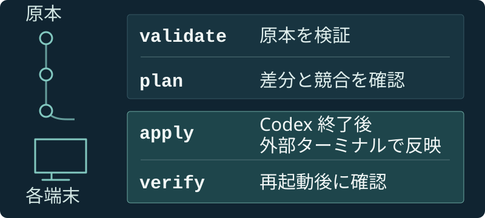

# shared-agents-config

WindowsとmacOSで使うCodexの共通ルール、エージェントの役割、スキルを管理するリポジトリです。設定の変更はGitで管理する原本に加え、各端末に適用します。



適用するコミットを決めたら、作業ツリーがクリーンな状態で `validate` と `plan` を再実行します。差分の内容を確認し、`apply_blocked` が `false` なら適用に進みます。

[環境を準備する](#準備) · [既存の設定を初めて移行する](docs/manual-verification.md#初回導入と旧配置の移行) · [共通設定を更新する](docs/manual-verification.md#通常の適用)

## 管理対象

| リポジトリの原本 | 端末の配置先 | 管理する内容 |
|---|---|---|
| [AGENTS.md](AGENTS.md) | `CODEX_HOME/AGENTS.md` | 管理マーカー内の共通ルール |
| [agents/](agents/) の `*.toml` | `CODEX_HOME/agents/` | 役割ごとの設定ファイル |
| [skills/](skills/) の `<name>/` | `~/.agents/skills/<name>/` | Gitで追跡しているファイル |
| [skills-policy.toml](config/skills-policy.toml) | `CODEX_HOME/config.toml` と `~/.agents/skills/` | 個別スキルの無効化と、公式Superpowers v5.1.0に一致する旧ファイルの削除 |
| [dependencies.toml](config/dependencies.toml) | 配布なし | 検証・診断に使う必須の外部スキル名 |

`CODEX_HOME` を決める優先順は、CLIの `--codex-home`、環境変数 `CODEX_HOME`、ホーム配下の `.codex` です。ユーザースキルはホーム配下の `.agents/skills/` に置きます。このホームは `--home` で指定できます。

認証ファイル、MCP、project trust、通知、対象外のスキル設定は各端末で管理します。プロジェクト間の関係やアプリ固有の制約は各プロジェクトの `AGENTS.md` に書きます。個人スキルの原本はこのリポジトリの `skills/` に置き、リポジトリ内の `.agents/skills/` には複製しません。

## モデル構成

| 役割 | 用途 | モデル | 推論強度 | sandbox |
|---|---|---|---|---|
| `explorer` | 実装前の調査 | `gpt-6-luna` | `high` | `read-only` |
| `implementer` | 方針が決まった変更の実装 | `gpt-6.1-terra` | `high` | `workspace-write` |
| `tester` | 再現テストと回帰テスト | `gpt-6-luna` | `high` | `workspace-write` |
| `reviewer` | 通常のコードレビュー | `gpt-6.2-sol` | `medium` | `read-only` |
| `reviewer_high_risk` | 権限やデータ整合性などのレビュー | `gpt-6.2-sol` | `high` | `read-only` |

5つの役割の設定元は [agents/](agents/) です。親エージェントのモデルと推論強度は端末ごとに設定し、既定値には `gpt-6.1-sol` / `high` を推奨します。難しい設計・分析では `xhigh`、Solでも解決できない場合は利用可能なAstraを検討します。

利用できるモデルはアカウント、ワークスペース、Codexクライアントによって異なります。モデルや役割を変更するときは、必要な範囲で対象モデルの利用可否と新規セッションでの動作を確認してください。[実動作確認](docs/manual-verification.md#実動作確認)

## 外部スキルの前提

SuperpowersはCodex公式のプラグインディレクトリから導入します。WindowsのCodexアプリとCodex CLIで動作を確認したバージョンは **Superpowers 7.0.1** です。旧版を個別に配置した端末には移行手順があります。[Superpowersのプラグイン版への移行](docs/manual-verification.md#superpowersのプラグイン版への移行)

各端末に `git-commit` もインストールし、Codexから呼び出せるようにします。リポジトリには必須の外部スキル名を記載し、インストール、更新、バージョンやリビジョンの管理は各環境で行います。クライアントのバージョン、端末別の確認日、実セッションでの役割・モデル・sandboxの確認結果は継続して記録しません。

## 運用方針

独立した作業は5つの役割に分担し、軽微な作業は親が直接扱います。commit・push・PR作成・mergeに必要な承認は、作業を委譲した場合も同じです。役割の選び方、親に判断を戻す条件、worktreeの配置、検証結果を再利用する条件は [AGENTS.md](AGENTS.md) に定めています。開発用の `.env` をworktreeへコピーするときは既存の手順に従います。

## 準備

Python 3.11以上とGitを用意し、リポジトリのルートで次のコマンドを実行します。ホストのPythonを使うのはバージョン確認と仮想環境の作成までです。以降のCLIとテストは仮想環境のPythonで実行します。

### Windows / PowerShell

```powershell
py -3.11 -m venv .venv
.\.venv\Scripts\python.exe -m pip install -r requirements-dev.txt
.\.venv\Scripts\python.exe -m harness validate
```

対応する別のPythonを使う場合は、1行目の `-3.11` をそのバージョンに合わせます。上の例はPythonを直接指定するため、仮想環境の有効化やPowerShellの実行ポリシー変更は不要です。

### macOS

```bash
python3 --version
python3 -m venv .venv
./.venv/bin/python -m pip install -r requirements-dev.txt
./.venv/bin/python -m harness validate
```

1行目でPython 3.11以上であることを確認してください。WSLはWindowsとは別のユーザー環境として扱い、パスは相互に変換しません。

上の例はテスト用のpytestも導入します。通常運用だけなら `-r requirements.txt` を指定してください。tomlkit、PyYAML、jsonschemaが入ります。各パッケージのバージョン範囲は依存ファイルに記載しています。[requirements.txt](requirements.txt)・[requirements-dev.txt](requirements-dev.txt)

## コマンド

リポジトリのルートで、仮想環境のPythonに `-m harness <コマンド>` を続けます。実機への `apply` はCodexを終了してから外部ターミナルで実行し、再起動後に `verify` で配置を確認します。[適用手順](docs/manual-verification.md)

| コマンド | 動作 | 終了コード `0` | `1` | `2` |
|---|---|---|---|---|
| `validate` | 原本の構文・参照先・役割・依存関係を検証 | 正常 | — | 原本が不正など |
| `plan` | 配布差分と競合を表示 | 一致 | 差分あり | 競合・不正 |
| `apply` | 排他ロックを取得し、差分を再評価して反映・検証・記録 | 成功 | — | 失敗 |
| `verify` | 管理対象の配置・反映したコミット・旧定義を照合 | 一致 | 不一致 | 読み取りエラーなど |
| `doctor` | 指定した依存パスや設定の上書きなどを診断 | 診断範囲に問題なし | 警告あり | 必須依存の不足など |

`validate`、`plan`、`verify` は配置先に書き込みません。`doctor` で調査用の診断記録を保存する場合は `--record` を付けます。

<details>
<summary>planの差分理由と適用を止める条件</summary>

`plan` の終了コード `1` は「反映する差分あり」を表します。差分には論理IDと操作の種類だけを表示し、設定やローカル追記の本文は表示しません。

通常表示とJSONのどちらでも、`difference_reasons` が差分の理由、`apply_blocked` が適用を止める要因の有無、`apply_blockers` がその内訳を示します。差分の理由コードには `not-recorded`、`source-commit-changed`、`managed-content`、`adoption`、`retired-files`、`orphaned-override`、`conflict` があります。

これらの項目は `status` や終了コードとは別に確認します。たとえば、配置が一致して終了コードが `0` でも、原本に未コミットの変更があれば `apply_blocked: true` です。[planの読み方](docs/manual-verification.md#planの読み方)

</details>

共通オプションは `--repo`、`--home`、`--codex-home`、`--local-config` です。サブコマンドの後に指定してください。実機ではCodexが使う配置先に合わせ、テストではホームと `CODEX_HOME` の両方に一時ディレクトリを指定します。

## 文書の入口

| 知りたいこと | 読む文書 |
|---|---|
| 原本から端末に設定が届く仕組み | [構成](docs/architecture.md) |
| 作業の依頼方法と操作の承認範囲 | [プロンプト例](docs/PROMPTS.md) |
| 原本を変更して各端末に適用する手順 | [通常の適用](docs/manual-verification.md#通常の適用) |
| 既存のAGENTS.mdを初めて移行する手順 | [初回導入と旧配置の移行](docs/manual-verification.md#初回導入と旧配置の移行) |
| 競合や適用途中の失敗への対応 | [競合と失敗への対応](docs/manual-verification.md#競合と失敗への対応)・[診断](docs/manual-verification.md#問題がある場合) |
| 役割やモデルを変えた後の確認 | [実動作確認](docs/manual-verification.md#実動作確認) |
| 役割の静的検査とスキーマの更新 | [role検証仕様](docs/role-validation.md) |
| スキルの必須要件と静的検査 | [Skill検証仕様](docs/skill-validation.md) |
| スキルの評価方法と観測できる範囲 | [評価ガイド](evals/README.md) |
| SG/VPの期待シナリオと過去の実行結果 | [trigger matrix](tests/implementing-repository-changes-trigger-matrix.md) |

## テスト

| 環境 | リポジトリのルートで実行するコマンド |
|---|---|
| Windows / PowerShell | `.\.venv\Scripts\python.exe -m pytest -q` |
| macOS | `./.venv/bin/python -m pytest -q` |

文書の差分は `git diff --check` で確認します。CIではWindowsとmacOSのそれぞれでPython 3.11と3.14を使います。結果の参照先はGitHub Actionsです。実行URLや端末別の結果を別のMarkdownに転記する必要はありません。

通常のpytestは一時Gitリポジトリ、合成データ、模擬実行だけを使います。個人設定や認証情報は使いません。実モデルでの評価は明示した手動実行に限ります。静的検査や配置確認が成功しても、実際のスキル選択、役割の起動、モデルの動作を観測できなかった項目は未確認として扱います。
